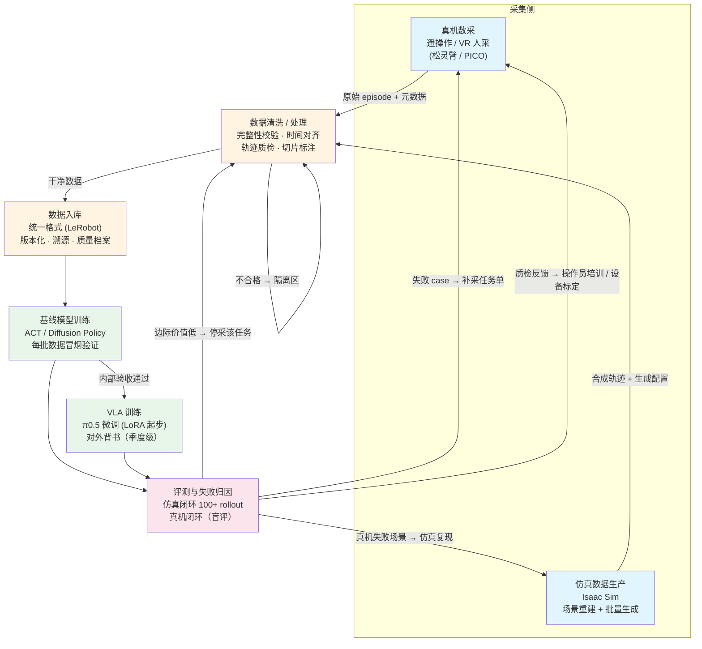

# 具身数据团队构建流程图

面向实验室团队搭建的总体流程：从数据采集到模型验证的完整链路，以及各阶段人员配置建议。

## 一、主流程图



## 二、各阶段职责与人员配置

### 阶段 1：真机数采（遥操作 / VR 人采）

| 角色 | 人数 | 职责 | 技能要求 |
|---|---|---|---|
| **数据采集工程师** | 1 | 采集系统搭建与维护：遥操作链路、传感器标定、时间同步、采集脚本 | 机器人硬件、ROS 2、标定 |
| **操作员（遥操作/VR）** | 2-4 | 按任务单执行采集，保证演示质量 | 可培训上岗，流动性岗位 |
| **采集组长**（可兼） | 0.5 | 任务排期、操作员管理、质量复盘 | 熟悉质检指标 |

关键机制：**操作员按"边际成功率贡献"考核，不按条数考核**（详见数据飞轮文档）。

### 阶段 2：仿真数据生产（Isaac Sim）

| 角色 | 人数 | 职责 | 技能要求 |
|---|---|---|---|
| **仿真工程师** | 1-2 | 场景/资产搭建、域随机化配置、批量轨迹生成、真机失败场景复现 | Isaac Sim/Lab、USD、Python |
| **3D 资产**（可外包） | 0-1 | 物体/场景建模、材质制作 | 3D 建模工具 |

关键机制：每条轨迹记录完整生成配置（种子、随机化参数），保证可复现、可切片分析。

### 阶段 3：数据清洗 / 处理

| 角色 | 人数 | 职责 | 技能要求 |
|---|---|---|---|
| **数据工程师** | 1-2 | 自动化质检管线（jerk/停顿/回退/延迟检测）、时间对齐、格式转换、覆盖矩阵与多样性统计 | Python、信号处理、数据处理管线 |
| **标注/评审员**（可兼职轮值） | 1-2 | 5% 抽检、打标 episode 复核、语言指令标注 | 按 rubric 培训 |

关键机制：自动质检为门禁，人工只做抽检与仲裁；评审双人 + Cohen's kappa 一致性监控。

### 阶段 4：数据入库

| 角色 | 人数 | 职责 | 技能要求 |
|---|---|---|---|
| **平台工程师**（可与数据工程师兼任） | 0.5-1 | 数据版本管理（DVC/元数据库）、episode 级溯源、质量档案维护、权限与存储 | 数据库、存储系统、工具链开发 |

关键机制：原始数据不可变（raw zone），处理数据带版本（processed zone）；任何 episode 可反查采集人/设备/质检分/使用记录。

### 阶段 5：基线模型训练（ACT / DP）

| 角色 | 人数 | 职责 | 技能要求 |
|---|---|---|---|
| **算法工程师** | 1-2 | 每批数据冒烟训练、仿真闭环评测、失败归因、数据版本对比实验 | 模仿学习、PyTorch、LeRobot 生态 |

关键机制：固定对照实验设计（锁住一切只动数据）；checkpoint 按 rollout 成功率选，不按 loss；每任务 ≥50 trials 保证统计显著性。

### 阶段 6：VLA 训练（π0.5 微调）

| 角色 | 人数 | 职责 | 技能要求 |
|---|---|---|---|
| **算法工程师**（与基线共用） | 0.5-1 | 季度级 π0.5 微调（LoRA 起步）、分层评测（已见/未见/全新任务）、对外背书材料 | VLA 微调、多卡训练 |
| **算力** | — | LoRA 1-4×A100；全量 8×A100/H100（可租用，按需） | — |

关键机制：VLA 是背书的上限不是前提，低频执行（季度/重大版本）；评测任务集继承基线的子集。

## 三、团队规模参考

| 团队阶段 | 总人数 | 配置重点 |
|---|---|---|
| **起步期**（跑通飞轮） | 6-8 人 | 采集工程师 1 + 操作员 2 + 仿真 1 + 数据工程师 1 + 算法 1-2；入库平台由数据工程师兼任，VLA 暂缓 |
| **成长期**（数据上量） | 12-15 人 | 操作员扩到 4-6、仿真 2、数据工程师 2、算法 2-3、平台工程师独立 1 |
| **对外背书期** | +1-2 人 | 增加 VLA 专项算法 + 评测专员（盲评执行） |

## 四、岗位合并建议（小团队起步）

一个人可身兼的最小闭环（6 人版）：

```
采集工程师(1) + 操作员(2)      → 阶段 1
仿真工程师(1)                  → 阶段 2
数据工程师(1)                  → 阶段 3 + 4
算法工程师(1)                  → 阶段 5（VLA 先不做或外包算力低频做）
```

两条不可合并的红线：

1. **采集的人不能评审自己的数据**（盲评原则）
2. **训练的人不能指定评测任务集后又自己评测**（评测协议独立）

## 五、协作节奏（对应飞轮）

| 周期 | 动作 | 参与方 |
|---|---|---|
| 每日 | 采集执行 + 自动质检 | 阶段 1/2/3 |
| 每周 | 新批次冒烟训练 + 失败 case 评审会 → 补采任务单 | 阶段 3/5 + 采集组长 |
| 每月 | 覆盖矩阵审计 + 操作员/设备质量复盘 | 阶段 3/4 + 各组长 |
| 每季度 | VLA 微调 + 真机盲评 + 背书材料更新 + 仿真/真机相关性校准 | 全链路 |
